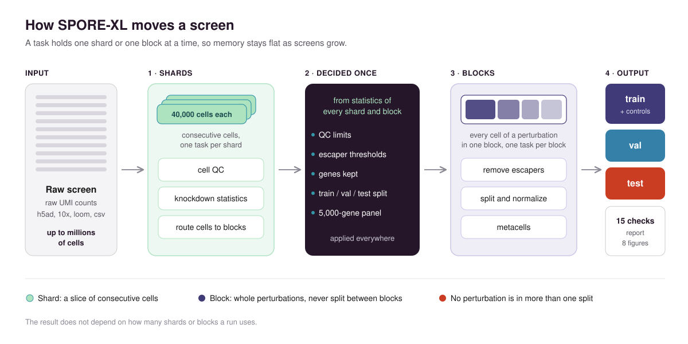
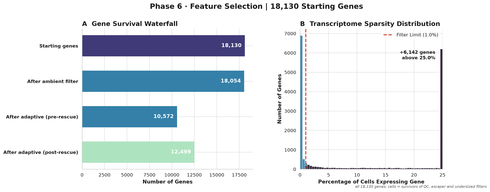
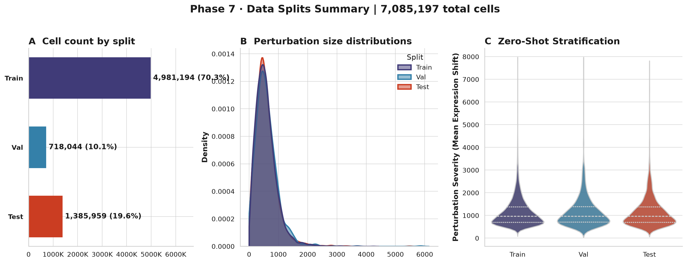

```
  ███████╗██████╗  ██████╗ ██████╗ ███████╗    ██╗  ██╗██╗
  ██╔════╝██╔══██╗██╔═══██╗██╔══██╗██╔════╝    ╚██╗██╔╝██║
  ███████╗██████╔╝██║   ██║██████╔╝█████╗       ╚███╔╝ ██║
  ╚════██║██╔═══╝ ██║   ██║██╔══██╗██╔══╝       ██╔██╗ ██║
  ███████║██║     ╚██████╔╝██║  ██║███████╗    ██╔╝ ██╗███████╗
  ╚══════╝╚═╝      ╚═════╝ ╚═╝  ╚═╝╚══════╝    ╚═╝  ╚═╝╚══════╝
  Systematic Preprocessing and Optimization for Robust Evaluation
  sharded, memory-bounded Perturb-seq preprocessing
```

# SPORE-XL: Systematic Preprocessing and Optimization for Robust Evaluation

**SPORE-XL turns a raw CRISPR Perturb-seq screen of any size into a clean, leakage-free train / validation / test dataset, proves its own output with 15 verification checks, and gives the same result on a laptop, in an interactive cluster session and in a SLURM job.\***

    



---

## At a glance

| | |
|---|---|
| screens processed | 4 CRISPRi screens in 4 cell types: leukemia line, primary T cells, epithelial line, embryonic stem cells |
| largest screen | 7,679,247 cells and 11,700 perturbations (primary CD4+ T cells) |
| speed | 2 million cells in 38 minutes on 32 CPUs; about 1.4 core-hours of compute per million cells |
| memory | 14 to 27 GB for the most demanding single task, whatever the screen's size |
| leakage | every perturbation in exactly one split, proven on every run |
| held-out targets in the gene panel | 100% of the measurable ones, in all four screens |
| reproducibility | identical results across a laptop, an interactive cluster session and a SLURM job\* |

\* *Every cleaning and splitting result is identical across all three. The metacells, the last step, differ by about 0.1% between a Windows laptop and a Linux cluster, because k-means rounding depends on the processor. [Details](#identical-across-environments).*

---

## Four screens, four cell types

SPORE-XL has processed four public CRISPRi screens that differ in cell type, size, sequencing depth and design. Every run passed all 15 verification checks and was declared ready for network inference. The table grows with every screen SPORE-XL treats.

### The screens

| screen | cell type | cells | genes measured | perturbations | cells per perturbation | control cells | batches |
|---|---|---|---|---|---|---|---|
| [K562 genome-wide](docs/showcase/k562/REPORT.md) (Replogle 2022) | K562, chronic myeloid leukemia | 1,989,578 | 8,248 | 9,866 | 187 | 75,328 | 267 |
| [CD4+ T, resting](docs/showcase/cd4_t_rest/REPORT.md) (GSE314342) | primary human CD4+ T cells | 7,679,247 | 18,130 | 12,725† | 577 | 329,288† | 47 |
| [RPE1 essential](docs/showcase/rpe1/REPORT.md) (Replogle 2022) | RPE1, retinal pigment epithelium | 247,914 | 8,749 | 2,393 | 128 | 11,485 | 56 |
| [H1 hESC](docs/showcase/h1_hesc/REPORT.md) (Virtual Cell Challenge) | H1 human embryonic stem cells | 221,273 | 18,080 | 150 | 1,026 | 38,176 | 48 |

Cells per perturbation is measured after cleaning. †For CD4+ T, perturbations and control cells are counted after cell QC; the other screens count them before. Each screen name links to the report SPORE-XL wrote for that run, with its eight figures.

### What SPORE-XL did to them

| screen | cells removed by QC | escapers removed | perturbations dropped as too small | cells kept | perturbations kept | genes kept | train / val / test | batch-confounded perturbations flagged |
|---|---|---|---|---|---|---|---|---|
| K562 | 11,599 (0.6%) | 169,940 (8.9%) | 748 | 1,783,992 (89.7%) | 9,118 | 8,247 | 6,720 / 800 / 1,598 | 22 |
| CD4+ T | 6,030 (0.1%) | 569,282 (7.8%) | 1,025 | 7,085,197 (92.3%) | 11,700 | 12,499 | 8,252 / 1,148 / 2,300 | 27 |
| RPE1 | 87 (0.04%) | 17,646 (7.5%) | 879 | 205,015 (82.7%) | 1,514 | 8,739 | 1,058 / 152 / 304 | 0 |
| H1 hESC | 26,925 (12.2%) | 9,175 (5.7%) | 2 | 185,117 (83.7%) | 148 | 14,145 | 88 / 20 / 40 | 0 |

Escaper percentages are of the perturbed cells that passed QC. Every report closes its cell waterfall with a reconciliation, so the cells kept plus every cell removed add up to the cells that entered.

### How fast, on what

| screen | environment | CPUs | wall time | compute (core-hours) | core-hours per million cells |
|---|---|---|---|---|---|
| K562 (2.0 M cells) | SLURM job | 32 | 38 min | 2.7 | 1.4 |
| CD4+ T (7.7 M cells) | SLURM jobs | 16† | 1 h 55 min† | 10.2 | 1.3 |
| RPE1 (248 k cells) | SLURM job | 16 | 8 min | 0.34 | 1.4 |
| RPE1 (248 k cells) | Windows laptop | 6 cores, 12 threads | about 15 min | 0.79 | 3.2 |
| H1 hESC (221 k cells) | interactive cluster session | 16 | 8 min | 0.41 | 1.9 |
| H1 hESC (221 k cells) | SLURM job | 16 | 10 min | 0.40 | 1.8 |

Compute is the running time of every task summed. Each task uses one core, so compute divided by the number of cores estimates the wall time on any machine, and it grows almost linearly with the number of cells: about 1.4 core-hours per million cells on a cluster node. The laptop runs 12 tasks on 6 physical cores, so each task takes longer and the sum is higher. †CD4+ T ran in two parts: reading the raw 10x Flex files, planning and the first QC pass (17.5 min), then the rest as one 16-CPU job (1 h 37 min). The [hardware](#test-hardware) is listed at the end of this page.

The memory a run needs is set by its most demanding single task, not by the size of the screen: 14.3 GB for K562, 17.5 GB for CD4+ T, 13.8 GB for RPE1 and 26.9 GB for H1 hESC (its gene-panel step works on 18,080 measured genes).

---

## How it works

A single-cell screen of several million cells does not fit in the memory of most machines, and the steps that clean it need to see every cell of a perturbation at once. SPORE-XL resolves this by moving the data twice. It first cuts the input into **shards** of 40,000 consecutive cells and computes everything that only needs one cell at a time: cell QC and the statistics that set the knockdown thresholds. It then routes every cell into a **block** that holds whole perturbations, so every step that needs all of a perturbation's cells (the escaper filter, the split, normalization, metacells) works on one block at a time. A task never holds more than one shard or one block, which is why memory stays flat as screens grow.

Global decisions, such as the QC limits, the escaper thresholds, the split and the gene panel, are made once from statistics gathered across all shards or blocks, and then applied everywhere. The result does not depend on how many shards or blocks a run uses, and the test suite checks this by cutting the same screen into 1, 3 and 7 shards and comparing the outputs.

| phase | what it does |
|---|---|
| 1. Intake | reads h5ad, 10x h5 / mtx, loom, csv / tsv and R-exported HDF5, and confirms the matrix holds raw counts |
| 2. Gene IDs | converts Ensembl or Entrez IDs to gene symbols |
| 3. Cell QC | removes cells by UMI count, genes detected and mitochondrial fraction; ribosomal perturbation targets are exempt from ribosomal filtering |
| 4. Escaper filter | removes cells whose target gene did not drop below the controls, then drops perturbations left with too few cells |
| 5. Gene QC | removes genes too sparse to model while keeping every perturbation target |
| 6. Split | assigns whole perturbations to train, validation or test, stratified by response strength |
| 7. Gene panel | selects 5,000 highly variable genes on training cells only, always including the held-out targets and your protected genes |
| 8. Normalization | library-size scaling and log transform on the panel; raw counts are kept alongside |
| 9. Metacells | pools each perturbation's cells into metacells and keeps every control as a single cell |
| 10. Verification and report | runs the 15 checks and writes the report and figures |

[How it works](docs/HOW_IT_WORKS.md) covers each stage in depth.

### Cell QC


*Genes detected (A), total UMI count (B) and mitochondrial fraction (C) per cell on the H1 hESC screen before filtering. H1 is the screen where QC mattered most: 12.2% of its cells exceeded the upper limits on genes detected or UMI count, the signature of doublets.*

### Knockdowns are verified, not assumed


*Knockdown efficiency and escaper calls for 9,118 perturbations of the K562 genome-wide screen. A cell is an escaper when its target gene stayed above the 10th percentile of that gene in the controls. SPORE-XL removed 169,940 escapers (8.9% of perturbed cells), each labeled as a knockdown but behaving like a control.*

Escapers teach a model that a knockdown does less than it does. SPORE-XL removes them, then drops any perturbation left with fewer than 50 cells. For targets too weakly expressed to judge this way, it also scores every cell by how much its whole transcriptome moved, and reports the cells that rule would add.

### Genes that carry signal, and the genes you need



*Gene QC on the CD4+ T cell screen: 18,130 measured genes, 12,499 kept. Genes too sparse to carry signal are removed; every perturbation target is kept regardless.*


*The 5,000-gene panel of the RPE1 screen, selected on training cells only. The targets of every validation and test perturbation that was measured are always in the panel, so a model can be scored on them; across the four screens this is 100% of the measurable held-out targets. A list of protected genes, such as transcription factors of interest, joins the panel the same way.*

### Why the splits can be trusted



*The split of the resting CD4+ T cell screen: 11,700 perturbations across 7.1 million cells. Whole perturbations go to one split each, which sets the cells in each split (A); the three splits hold perturbations of the same size distribution (B); and every split samples strong and weak perturbations in the same proportion (C). A model scored on the test set meets perturbations it has never seen, of the same kind it was trained on.*

SPORE-XL splits by perturbation, so every cell of a perturbation lands in exactly one of train, validation and test, and a model scored on the test set has never seen a cell of any test perturbation. Perturbations are ranked by how strongly they shift expression away from the controls and sampled into the three splits from every rank, so no split collects the easy or the hard cases (figure above). The verification step proves the split on every run rather than assuming it. Among its 15 checks:

- the train, validation and test label sets are disjoint and together cover every surviving perturbation
- every perturbation sits in exactly one split, and its cells after the escaper filter equal its cells in that split
- every control cell belongs to exactly one split
- no cell appears twice anywhere in the output
- the training metacell set contains no validation or test unit, and every metacell is built from a single perturbation
- every file the run wrote matches the checksum recorded when it was written

A run that fails any check exits with an error and names the check. Split sizes, the seed and the stratification are set in the config ([config reference](docs/CONFIG_REFERENCE.md)).

### Controls stay sharp

Metacells average a few cells of the same perturbation into one unit, which removes sampling noise from the perturbed cells. The controls are the reference every effect is measured against, so SPORE-XL never pools them: every control stays a single cell in every output. The training set for network inference holds the training metacells plus the single control cells, as raw counts and log-normalized.

---

## Identical across environments

A preprocessing result that changes with the machine it ran on cannot be reproduced by anyone else. SPORE-XL fixes its random seeds and processes cells in a fixed order, and we test the result by running the same screen in different environments and comparing every output.

| screen | comparison | cells, splits, controls, thresholds, genes, panel | metacells | proof |
|---|---|---|---|---|
| H1 hESC | interactive cluster session vs SLURM job | identical | identical | [comparison](docs/showcase/h1_hesc/IDENTITY.md) |
| RPE1 | interactive cluster session vs SLURM job | identical | identical | [comparison](docs/showcase/rpe1/IDENTITY.md) |
| RPE1 | Windows laptop vs Linux cluster | identical | 103,569 vs 103,681 units (0.1%)\* | [comparison](docs/showcase/rpe1/IDENTITY.md#windows-laptop-against-linux-cluster) |

\* The metacell step groups each perturbation's cells with k-means, whose arithmetic rounds slightly differently on different processors and math libraries. Everything upstream of it, from which cells survive to the split and the gene panel, is identical across platforms. Run logs, timings and folder paths differ between runs by design, and some `.h5ad` files differ byte for byte while holding identical data, because the HDF5 format records layout details that vary between writes; the comparison checks those files by content.

---

## What you get

- train, validation and test sets as AnnData (`.h5ad`): raw counts on the gene panel, and log-normalized
- metacells for every split, and a training set of metacells plus single control cells, raw and log-normalized
- the split file, the control assignment and the gene panel as plain files
- a per-perturbation table of knockdown evidence and of which perturbations became network nodes
- `REPORT.md` with the cell waterfall, batch and donor diagnostics and eight figures
- `VERIFICATION.md` with the result of every check, and `COVERAGE_REPORT.md` ending in GRAPH-READY

## Getting started

SPORE-XL needs Python 3.12.

```
git clone https://github.com/PatrickSheehan053/SPORE-XL.git
cd SPORE-XL
pip install --only-binary=:all: -r requirements_pinned.txt
cp configs/template.yaml my_run.yaml        # set the input file, the perturbation column and the control label
python spore_xl.py run --config my_run.yaml
```

On a SLURM cluster the same run is one job on one node:

```
sbatch --output=<log folder>/slurm_%j.out slurm/spore_xl.sbatch my_run.yaml
```

`run` finds the CPUs and memory available, chooses how many tasks to run at once, and resumes where it stopped if it is interrupted. Finished work is never redone or overwritten. On a machine other programs share, add `--workers` and `--max-ram-gb`. The [user guide](docs/USER_GUIDE.md) walks through a first run.

## Documentation

- [User guide](docs/USER_GUIDE.md): a first run, reading the report, loading the outputs, changing the defaults
- [Config reference](docs/CONFIG_REFERENCE.md): every setting, its default and what it changes
- [How it works](docs/HOW_IT_WORKS.md): sharding, blocks and each stage in depth
- [FAQ](docs/FAQ.md): unusual screens, splits, memory and reproducibility
- [Cluster setup](docs/HPC_SETUP.md): installing and running on SLURM
- [Known issues](docs/KNOWN_ISSUES.md) and [Changelog](CHANGELOG.md)

## Built on

Python 3.12 with numpy, scipy, pandas, anndata, scanpy (Seurat v3 highly variable genes), scikit-learn (MiniBatchKMeans metacells), h5py, pyarrow and matplotlib.

## Used in

- SPECTRA ([bioRxiv 2026](https://www.biorxiv.org/content/10.64898/2026.09.21.752624v1)) was trained on Perturb-seq screens prepared with SPORE.
- [FUNGI](https://github.com/PatrickSheehan053/FUNGI), a pipeline for cell-type-specific gene regulatory networks, uses SPORE-XL as its preparation stage.

## Citing

If you use SPORE-XL, please cite this repository and, until the preprint is out, the thesis that introduced it:

```
Sheehan, P. (2026). MYCELIUM: A Unified Pipeline for Causal Gene Regulatory Network
Inference from Single-Cell Perturbation Data. MSc thesis, University of Milan / Human Technopole.
```

Please also cite the original publication of every screen you process.

## References

1. Replogle, J. M. et al. Mapping information-rich genotype-phenotype landscapes with genome-scale Perturb-seq. *Cell* 185, 2559–2575 (2022).
2. Wolf, F. A., Angerer, P. & Theis, F. J. SCANPY: large-scale single-cell gene expression data analysis. *Genome Biol.* 19, 15 (2018).
3. Stuart, T. et al. Comprehensive integration of single-cell data. *Cell* 177, 1888–1902 (2019).

## Test hardware

Every number on this page comes from one of two machines.

| | cluster node | laptop |
|---|---|---|
| processor | Intel Xeon Gold 6226R, 2 × 16 cores, 2.9 GHz | Intel Core i7-9750H, 6 cores, 12 threads, 2.6 GHz |
| cores and memory | 32 cores and about 570 GB per node; each run used 16 or 32 cores, as listed above | 6 cores, 64 GB |
| operating system | Linux (Red Hat Enterprise Linux 8.8), SLURM | Windows 11 |
| software | Python 3.12.9, numpy 2.5.4, scipy 1.18.1, pandas 2.3.1, anndata 0.13.4, scanpy 1.12.4, scikit-learn 1.9.1 | same versions |

## License

MIT. See [`LICENSE`](LICENSE).
