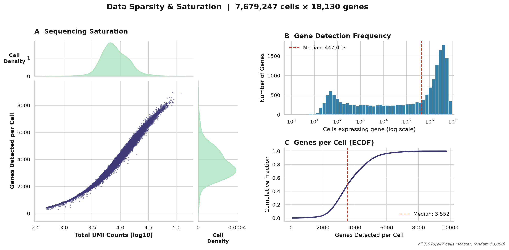
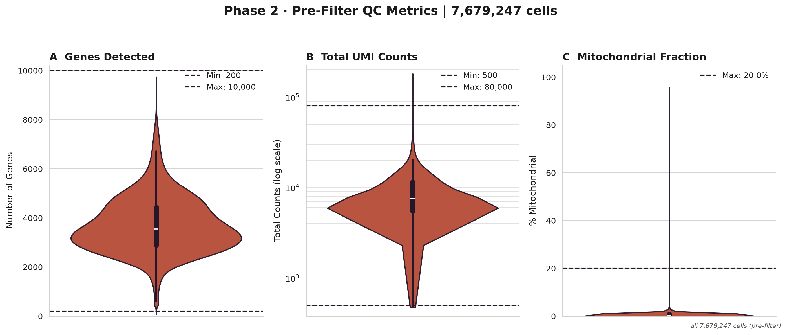
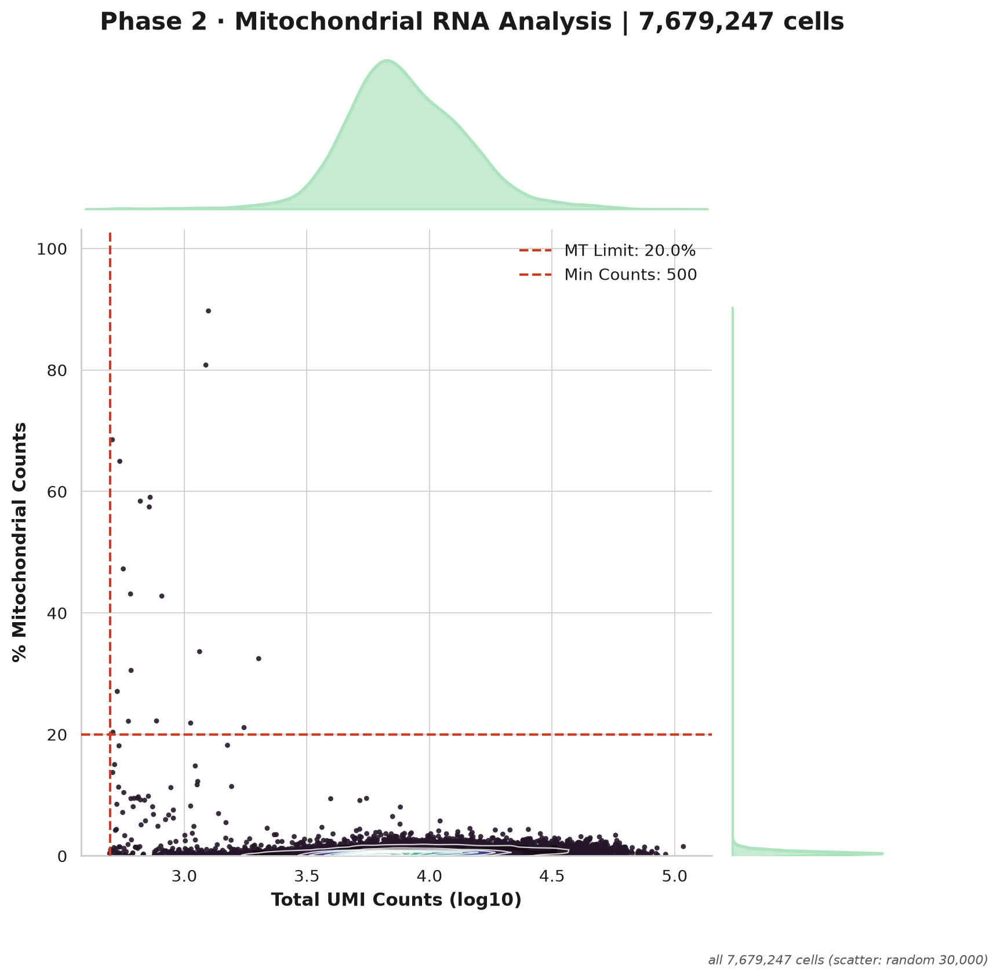
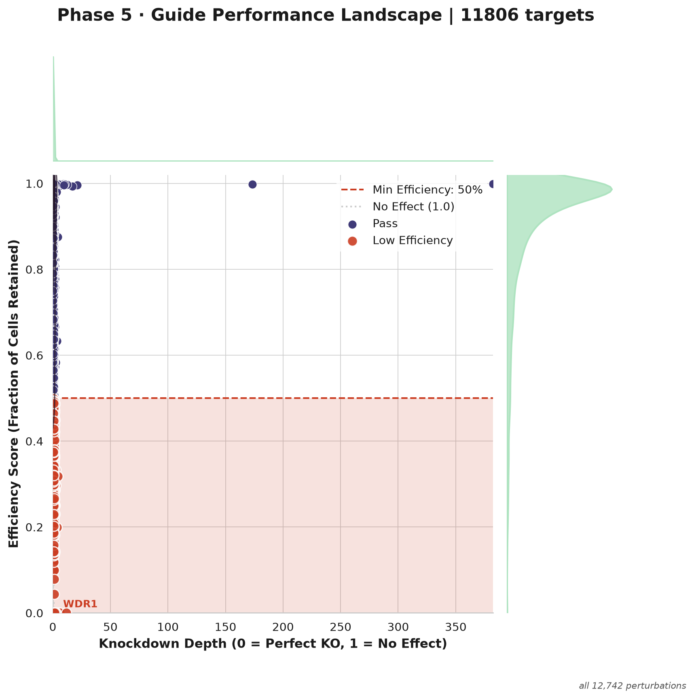
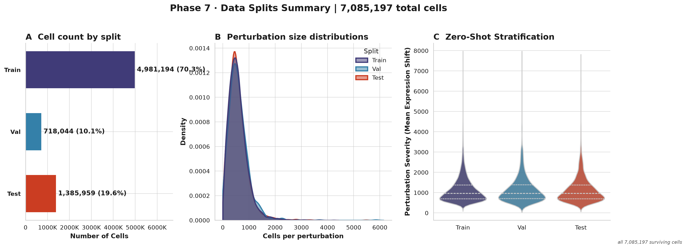
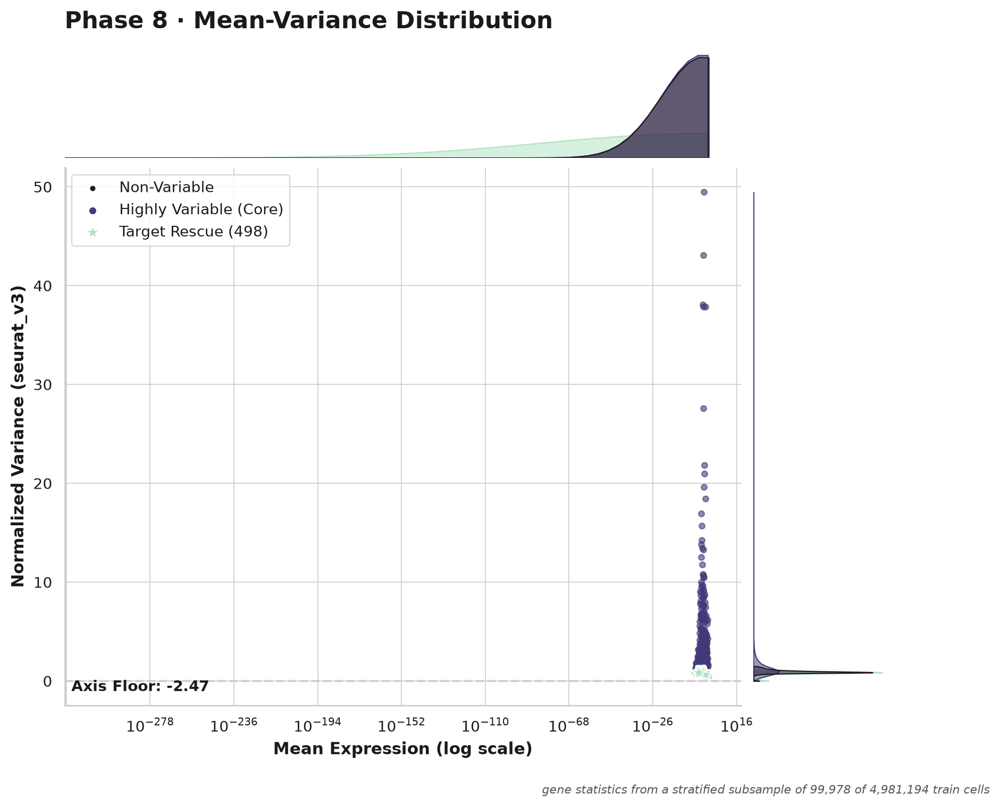
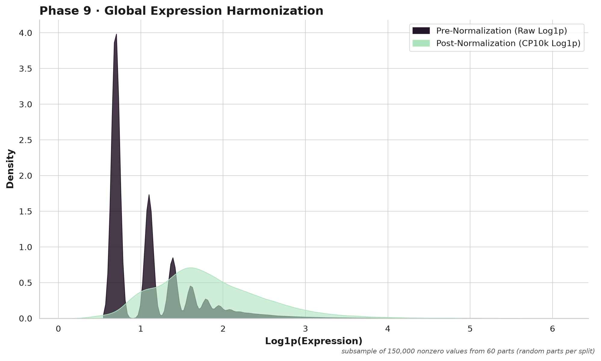

# SPORE-XL report: GSE314342_CD4T_Rest

> Resting primary human CD4+ T cells (GSE314342). Report written by SPORE-XL for this run; local paths removed.

## Figures

| figure | what | drawn from | status |
|---|---|---|---|
| sparsity_saturation.png | Input sparsity overview (phase 1-2) | all 7,679,247 cells (scatter: random 50,000) | ok |
| cell_qc_violin.png (alias p02_qc_violin.png) | Phase 3 cell QC violins | all 7,679,247 cells (pre-filter) | ok |
| cell_qc_mt_scatter.png (alias p02_mt_scatter.png) | Phase 3 cell QC MT scatter | all 7,679,247 cells (scatter: random 30,000) | ok |
| escaper_efficiency_scatter.png (alias p05_efficiency_scatter.png) | Phase 4 escaper filter / perturbation efficiency | all 12,742 perturbations | ok |
| gene_qc_dashboard.png (alias p06_triage_dashboard.png) | Phase 5 gene QC | all 18,130 genes; cells = survivors of QC, escaper and undersized filters | ok |
| split_dashboard.png (alias p07_splits_dashboard.png) | Phase 6 split | all 7,085,197 surviving cells | ok |
| hvg_dashboard.png (alias p08_hvg_dashboard.png) | Phase 7 HVG panel | gene statistics from a stratified subsample of 99,978 of 4,981,194 train cells | ok |
| normalization.png (alias p09_normalization.png) | Phase 8 normalization | subsample of 150,000 nonzero values from 60 parts (random parts per split) | ok |

No PCA / Harmony / cell-cycle-regression figures (old phase 10): that phase is not in the v4.0 core.

## Run summary

- cells in 7,679,247; survivors to Phase 7 7,085,197; controls 329,288; perturbations 11,700; genes kept by Phase 6 12,499
- split (perturbations): train 8252, val 1148, test 2300
- HVG panel 5000 genes (policy and counts below)

## Perturbation-target node policy (phase 7, HVG panel; mode production)

- n_subsample: 99978
- n_train: 4981194
- n_panel: 5000
- n_genes_phase6: 12499
- n_ghosts_stacked: 0
- rescued_target: 498
- rescued_protected: 153
- rescued_heldout: 2001
- target_node_policy: budget
- n_top_genes: 5000
- max_target_nodes: 4300
- panel_size: 5000
- panel_stacked_above_n_top: 0
- forced_heldout_targets: 3225
- forced_protected_genes: 334
- forced_cell_cycle_genes: 0
- train_targets_candidates: 7463
- train_targets_added: 842
- train_targets_dropped_by_budget: 6621
- target_nodes_in_panel: 1549
- hvgs_from_variance_rank: 689

Node perturbations (target gene is a column of the outputs) versus row-only perturbations (cells kept, target not a node); per perturbation in manifest/perturbation_nodes.tsv:

| reason | perturbations | cells |
|---|---|---|
| heldout_forced | 3,225 | 1,873,460 |
| hvg_variance_rank | 474 | 251,532 |
| protected | 233 | 125,866 |
| target_not_measured_or_removed_by_gene_qc | 779 | 453,761 |
| train_over_budget | 6,147 | 3,214,612 |
| train_ranked_in_budget | 842 | 836,678 |

## Escaper rules (phase 4; escaper_score = report)

Applied: rule 1 only. Per perturbation in reports/escaper_rules.tsv. Counts are over the QC-passing cells of the 12,742 perturbations.

| | cells | share of perturbation cells |
|---|---|---|
| rule 1 flags (target above the control 10th percentile) | 569,282 | 7.8% |
| rule 2 flags (response score, 12,238 perturbations where it could be computed) | 5,583,334 | 76.1% |
| flagged by both | 439,258 | |
| rule 1 only | 128,964 | |
| rule 2 only | 5,144,076 | |
| removed by the applied rule | 569,282 | 7.8% |

Rule 2 not computable for 504 perturbations: fewer than 20 cells 504.

Perturbations where rule 2 flags the most cells that rule 1 misses (candidates for the low-expressed-target blind spot):

| perturbation | cells | rule 1 | rule 2 | both |
|---|---|---|---|---|
| CYP20A1 | 3808 | 149 | 3337 | 142 |
| CDC25A | 3760 | 70 | 2879 | 53 |
| HIST1H4I | 2826 | 0 | 2689 | 0 |
| LRRC37A3 | 3258 | 2 | 2654 | 1 |
| DMRTB1 | 3013 | 0 | 2502 | 0 |
| WDFY1 | 8967 | 5610 | 5951 | 3453 |
| RASAL3 | 3481 | 311 | 2731 | 245 |
| TRAF3 | 6789 | 939 | 2872 | 548 |
| ORM2 | 2576 | 0 | 2301 | 0 |
| ZNF483 | 2421 | 1 | 2117 | 1 |

## Diagnostics (nothing is changed by them)

### Perturbation x batch confounding

- 47 batches; reference batch mix = controls (329,288 cells); a perturbation is flagged when its total variation distance (TVD) from the reference is >= 0.5 AND beyond random sampling of the same number of reference cells (Monte Carlo p <= 0.001); the fixed-threshold rule alone would flag 27
- Cramer's V between perturbation and batch (perturbations with >= 20 cells): 0.068
- perturbations entirely in one batch: 0
- **WARNING: 27 of 11700 perturbations (2,926 of 6,755,909 cells) have a batch mix unlike the controls.** A model can learn the batch instead of the perturbation for these (worst 10 below; all in stats/reduce2/all/confounding.tsv)

| perturbation | cells | dominant batch | max share | TVD | TVD expected by chance | p |
|---|---|---|---|---|---|---|
| ORC1 | 56 | R2L16 | 0.11 | 0.60 | 0.36 | 0.0005 |
| SMC1A | 50 | R2L11 | 0.12 | 0.58 | 0.37 | 0.0005 |
| COX14 | 64 | R2L5 | 0.16 | 0.57 | 0.34 | 0.0005 |
| CENPK | 55 | R2L10 | 0.11 | 0.57 | 0.36 | 0.0005 |
| ISG20L2 | 52 | R2L10 | 0.08 | 0.57 | 0.37 | 0.0005 |
| INTS2 | 86 | R2L24 | 0.09 | 0.56 | 0.29 | 0.0005 |
| TWISTNB | 81 | R2L8 | 0.09 | 0.54 | 0.30 | 0.0005 |
| EIF4A3 | 73 | R2L21 | 0.08 | 0.54 | 0.32 | 0.0005 |
| FBXO5 | 61 | R2L11 | 0.08 | 0.54 | 0.35 | 0.0005 |
| ANAPC1 | 109 | R2L19 | 0.08 | 0.54 | 0.26 | 0.0005 |

### Variance explained on the HVG subsample (train cells only, log-normalized panel genes)

99,978 cells x 5,000 genes. R2 = share of total variance; adjusted R2 corrects for the number of groups (perturbation has many groups, so only the adjusted value is comparable).

| factor | groups | R2 | adjusted R2 |
|---|---|---|---|
| perturbation | 8253 | 0.088999 | 0.007041 |
| batch | 47 | 0.005902 | 0.005445 |
| donor | 4 | 0.010592 | 0.010563 |

### Cell-cycle score diagnostic

- 42 S and 52 G2M genes present; score variance S 0.1655, G2M 0.2509
- phase fractions: {'G1': 0.5489, 'G2M': 0.2295, 'S': 0.2216}
- adjusted R2 of the scores by perturbation: S 0.00743773695590666, G2M 0.006262887748436863; by batch: S 0.002733358973631028, G2M 0.0015345357041820495

## Phase numbering (v4.0; old SPORE v3.0 numbers in the second column)

| v4 phase | name | v3.0 phase | config section |
|---|---|---|---|
| 1 | Intake / formatting | new | xl.source / recipe |
| 2 | Gene-ID harmonization | 1 | phase1_detection |
| 3 | Cell QC | 2 | phase2_cell_triage |
| 4 | Escaper filter + perturbation triage | 5 | phase5_escaper_filtering |
| 5 | Gene QC | 6 | phase6_gene_triage |
| 6 | Split | 7 | phase7_splits |
| 7 | HVG panel | 8 | phase8_hvg |
| 8 | Normalization | 9 | phase9_normalization |
| 9 | Metacell substrate | 12 | phase12_metacell |
| 10 | Verification + report | new | - |

Not in the core any more (future modules): v3.0 phases 3 ambient RNA, 4 doublets, 10 PCA / Harmony / cell-cycle regression, 11 cell-line separation. v3.0 output names are kept as aliases for one release (ON).

## Coverage and firewall

# GSE314342_CD4T_Rest — SPORE substrate coverage + firewall verification
_(generated by the SPORE-XL final gate)_

- **held-out (val+test) target node coverage: 93.53%** (3225/3448)
  - val 94.95% (1148 targets) · test 92.83% (2300 targets)
- missing held-out targets: 223 (never-measured ceiling: 223; measured-but-filtered: 0)

- **PASS ✓** — coverage at measurable ceiling (missing ⊆ never-measured)  (0 measured held-out targets missing)
- **PASS ✓** — train-hybrid firewall (0 val/test units)  (0 val/test units in train hybrid)
- **PASS ✓** — substrate is HVG-panel RAW counts  (5000 genes; control units integer=True; max=197.0)

- merge: merged files NOT written: projected 167.1 GB vs xl.merge_cap_gb 40 GB (xl.merge_split_outputs: never); the per-block parts under processed/ are the output

## ✅ GRAPH-READY

## Time and peak RSS per stage

| stage | units | peak RSS max (GB) | seconds sum | seconds max |
|---|---|---|---|---|
| finalize | 1 | 16.77 | 1199.06 | 1199.06 |
| gather | 131 | 13.57 | 10093.55 | 97.84 |
| hvg | 1 | 17.51 | 942.03 | 942.03 |
| intake | 94 | 7.96 | 5855.81 | 78.5 |
| map1 | 94 | 7.64 | 4126.15 | 53.75 |
| map2 | 94 | 3.5 | 4644.15 | 62.02 |
| map3 | 131 | 7.53 | 3670.8 | 57.92 |
| metacell | 131 | 16.7 | 5305.95 | 51.66 |
| metacell_prep | 1 | 9.18 | 248.28 | 248.28 |
| plan | 1 | 2.12 | 82.5 | 82.5 |
| reduce1 | 1 | 4.86 | 55.71 | 55.71 |
| reduce2 | 1 | 11.67 | 97.35 | 97.35 |

## Clean-up

not active (default): no intermediate file was removed.

## Figure gallery

**Input sparsity and saturation**

**Cell QC metrics before filtering**

**Mitochondrial fraction against UMI count**

**Knockdown efficiency and escaper calls per perturbation**

**Gene QC**

**Train / validation / test split**

**Highly variable gene panel**

**Normalization**

