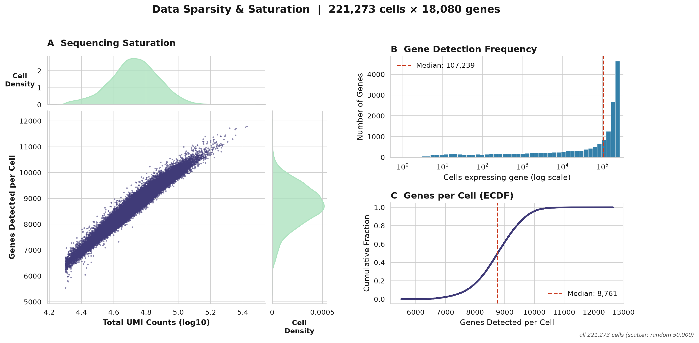
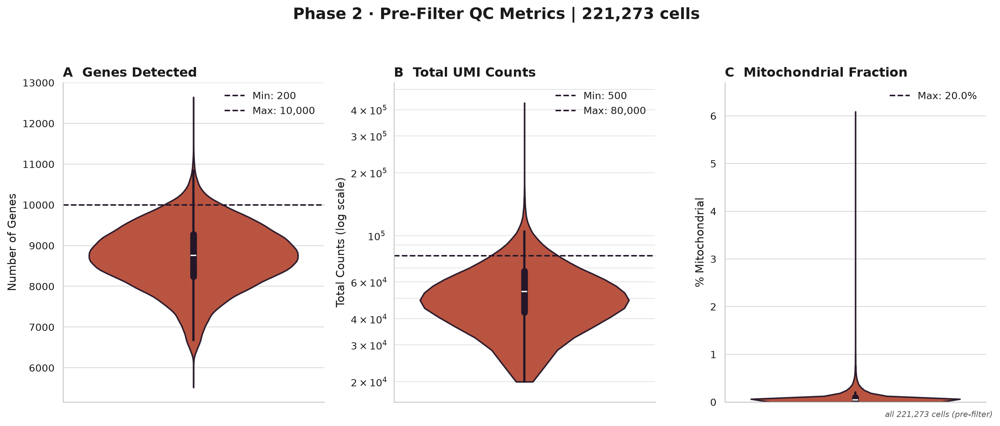
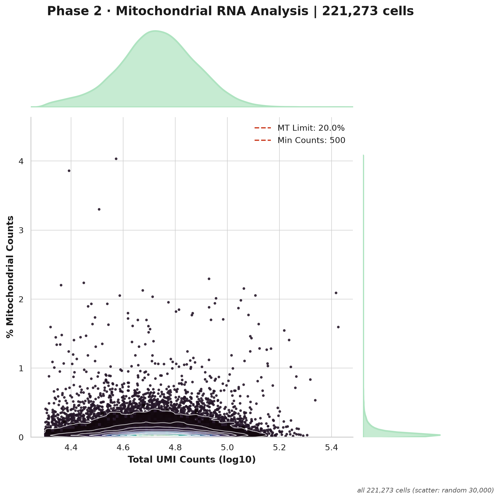
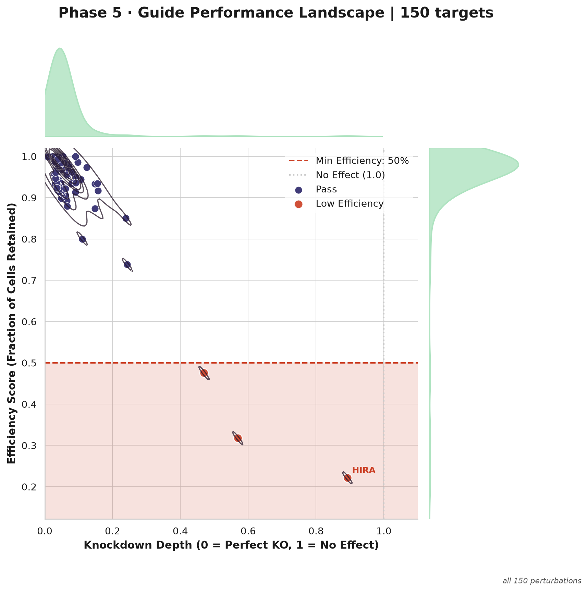
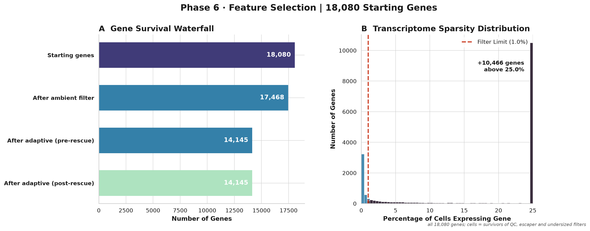
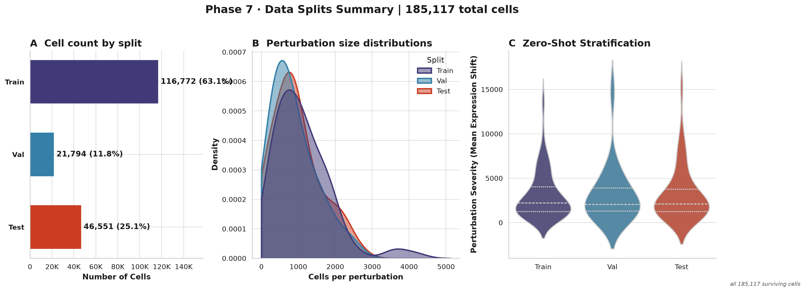
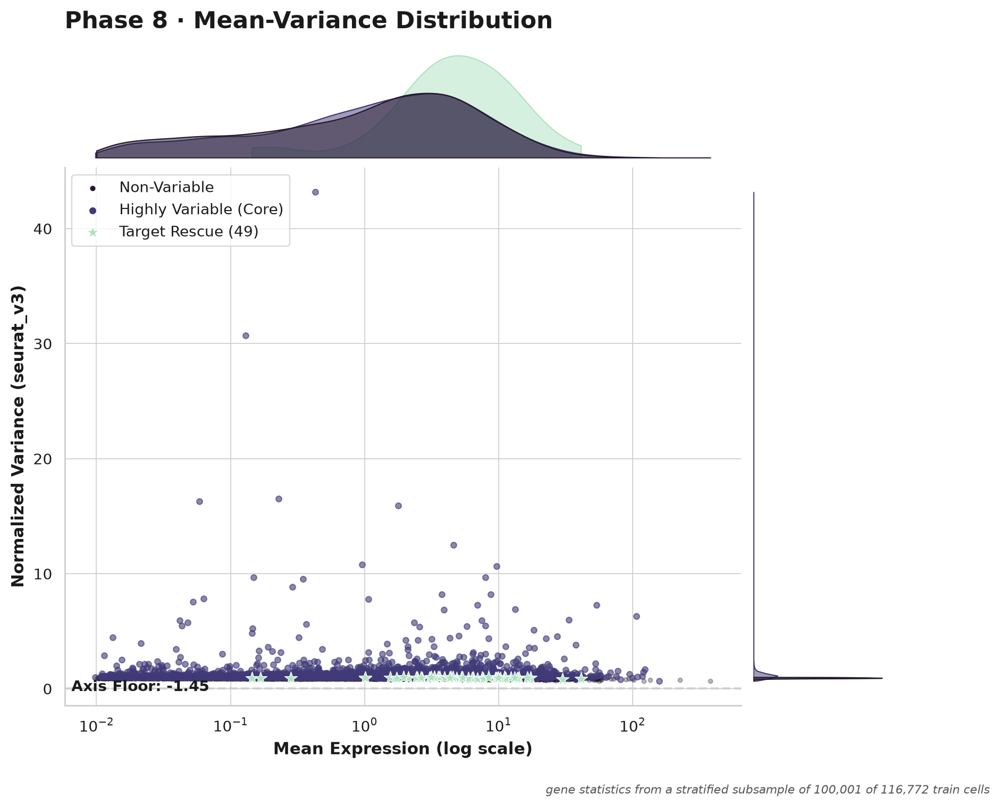
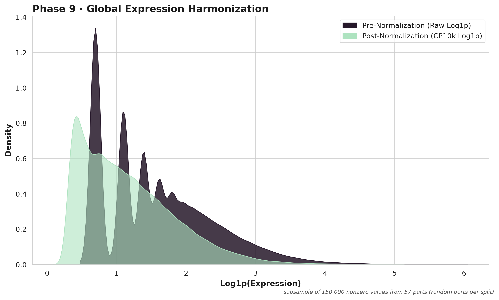

# SPORE-XL report: VCC_h1hESC

> H1 human embryonic stem cells (Virtual Cell Challenge training set). Report written by SPORE-XL for this run; local paths removed.

## Figures

| figure | what | drawn from | status |
|---|---|---|---|
| sparsity_saturation.png | Input sparsity overview (phase 1-2) | all 221,273 cells (scatter: random 50,000) | ok |
| cell_qc_violin.png (alias p02_qc_violin.png) | Phase 3 cell QC violins | all 221,273 cells (pre-filter) | ok |
| cell_qc_mt_scatter.png (alias p02_mt_scatter.png) | Phase 3 cell QC MT scatter | all 221,273 cells (scatter: random 30,000) | ok |
| escaper_efficiency_scatter.png (alias p05_efficiency_scatter.png) | Phase 4 escaper filter / perturbation efficiency | all 150 perturbations | ok |
| gene_qc_dashboard.png (alias p06_triage_dashboard.png) | Phase 5 gene QC | all 18,080 genes; cells = survivors of QC, escaper and undersized filters | ok |
| split_dashboard.png (alias p07_splits_dashboard.png) | Phase 6 split | all 185,117 surviving cells | ok |
| hvg_dashboard.png (alias p08_hvg_dashboard.png) | Phase 7 HVG panel | gene statistics from a stratified subsample of 100,001 of 116,772 train cells | ok |
| normalization.png (alias p09_normalization.png) | Phase 8 normalization | subsample of 150,000 nonzero values from 57 parts (random parts per split) | ok |

No PCA / Harmony / cell-cycle-regression figures (old phase 10): that phase is not in the v4.0 core.

## Run summary

- cells in 221,273; survivors to Phase 7 185,117; controls 33,321; perturbations 148; genes kept by Phase 6 14,145
- split (perturbations): train 88, val 20, test 40
- HVG panel 5000 genes (policy and counts below)

## Intake summary

- source: kind `h5ad_rows`, `VCC.h5ad`
- 221,273 cells and 18,080 genes enter the pipeline
- 150 perturbation labels and 38,176 control cells (`non-targeting`) before any QC

Cells dropped after the intake, and why (waterfall):

# WATERFALL (cells)

| step | cells | removed |
|---|---|---|
| in | 221,273 | |
| QC: After MT filter | 221,273 | 0 |
| QC: After min genes | 221,273 | 0 |
| QC: After max genes | 212,036 | 9,237 |
| QC: After min counts | 212,036 | 0 |
| QC: After max counts | 194,348 | 17,688 |
| escaper filter | 185,173 | 9,175 |
| undersized perturbations dropped (2 perturbations) | 185,117 | 56 |
| survivors to Phase 7 | 185,117 | |

cells in = survivors + removed: 221,273 = 185,117 + 26,925 (QC) + 9,175 (escapers) + 56 (undersized) -> RECONCILES

metacell units: 106,119 (79,779 in train_hybrid)
perturbation groups using the fallback embedding: 0

## Protected genes

- list: `protected_genes/protected_genes_h1_hESC.json` (name None, version 1.0); expression gate: off

## Perturbation-target node policy (phase 7, HVG panel; mode production)

- n_subsample: 100001
- n_train: 116772
- n_panel: 5000
- n_genes_phase6: 14145
- n_ghosts_stacked: 0
- rescued_target: 49
- rescued_protected: 60
- rescued_heldout: 39
- target_node_policy: budget
- n_top_genes: 5000
- max_target_nodes: 3500
- panel_size: 5000
- panel_stacked_above_n_top: 0
- forced_heldout_targets: 60
- forced_protected_genes: 118
- forced_cell_cycle_genes: 0
- train_targets_candidates: 82
- train_targets_added: 82
- train_targets_dropped_by_budget: 0
- target_nodes_in_panel: 88
- hvgs_from_variance_rank: 4748

Node perturbations (target gene is a column of the outputs) versus row-only perturbations (cells kept, target not a node); per perturbation in manifest/perturbation_nodes.tsv:

| reason | perturbations | cells |
|---|---|---|
| heldout_forced | 60 | 54,838 |
| protected | 6 | 8,859 |
| train_ranked_in_budget | 82 | 88,099 |

## Escaper rules (phase 4; escaper_score = report)

Applied: rule 1 only. Per perturbation in reports/escaper_rules.tsv. Counts are over the QC-passing cells of the 150 perturbations.

| | cells | share of perturbation cells |
|---|---|---|
| rule 1 flags (target above the control 10th percentile) | 9,175 | 5.7% |
| rule 2 flags (response score, 150 perturbations where it could be computed) | 73,074 | 45.4% |
| flagged by both | 4,381 | |
| rule 1 only | 4,794 | |
| rule 2 only | 68,693 | |
| removed by the applied rule | 9,175 | 5.7% |

Perturbations where rule 2 flags the most cells that rule 1 misses (candidates for the low-expressed-target blind spot):

| perturbation | cells | rule 1 | rule 2 | both |
|---|---|---|---|---|
| TMSB4X | 4214 | 37 | 3687 | 35 |
| NCK2 | 2542 | 159 | 2324 | 151 |
| IGF2R | 2668 | 102 | 2160 | 88 |
| SRC | 2103 | 63 | 1914 | 57 |
| KIF1B | 2097 | 11 | 1847 | 11 |
| PRCP | 3741 | 36 | 1835 | 26 |
| PBX1 | 1997 | 22 | 1794 | 22 |
| IDE | 1988 | 37 | 1754 | 34 |
| MAP3K7 | 1737 | 29 | 1529 | 28 |
| STAT1 | 2158 | 27 | 1525 | 25 |

## Diagnostics (nothing is changed by them)

### Perturbation x batch confounding

- 48 batches; reference batch mix = controls (33,321 cells); a perturbation is flagged when its total variation distance (TVD) from the reference is >= 0.5 AND beyond random sampling of the same number of reference cells (Monte Carlo p <= 0.001); the fixed-threshold rule alone would flag 0
- Cramer's V between perturbation and batch (perturbations with >= 20 cells): 0.032
- perturbations entirely in one batch: 0
- no perturbation is flagged

### Variance explained on the HVG subsample (train cells only, log-normalized panel genes)

100,001 cells x 5,000 genes. R2 = share of total variance; adjusted R2 corrects for the number of groups (perturbation has many groups, so only the adjusted value is comparable).

| factor | groups | R2 | adjusted R2 |
|---|---|---|---|
| perturbation | 89 | 0.030244 | 0.029389 |
| batch | 48 | 0.004859 | 0.004391 |
| donor | - | not available (no donor column) | |

### Cell-cycle score diagnostic

- 42 S and 52 G2M genes present; score variance S 0.0130, G2M 0.0226
- phase fractions: {'S': 0.5293, 'G2M': 0.4703, 'G1': 0.0004}
- adjusted R2 of the scores by perturbation: S 0.027751903424980684, G2M 0.019112099686854234; by batch: S 0.0026939219419955807, G2M 0.0041313774371501966

## Phase numbering (v4.0; old SPORE v3.0 numbers in the second column)

| v4 phase | name | v3.0 phase | config section |
|---|---|---|---|
| 1 | Intake / formatting | new | xl.source / recipe |
| 2 | Gene-ID harmonization | 1 | phase1_detection |
| 3 | Cell QC | 2 | phase2_cell_triage |
| 4 | Escaper filter + perturbation triage | 5 | phase5_escaper_filtering |
| 5 | Gene QC | 6 | phase6_gene_triage |
| 6 | Split | 7 | phase7_splits |
| 7 | HVG panel | 8 | phase8_hvg |
| 8 | Normalization | 9 | phase9_normalization |
| 9 | Metacell substrate | 12 | phase12_metacell |
| 10 | Verification + report | new | - |

Not in the core any more (future modules): v3.0 phases 3 ambient RNA, 4 doublets, 10 PCA / Harmony / cell-cycle regression, 11 cell-line separation. v3.0 output names are kept as aliases for one release (ON).

## Coverage and firewall

# VCC_h1hESC — SPORE substrate coverage + firewall verification
_(generated by the SPORE-XL final gate)_

- **held-out (val+test) target node coverage: 100.0%** (60/60)
  - val 100.0% (20 targets) · test 100.0% (40 targets)
- missing held-out targets: 0 (never-measured ceiling: 0; measured-but-filtered: 0)

- **PASS ✓** — coverage at measurable ceiling (missing ⊆ never-measured)  (0 measured held-out targets missing)
- **PASS ✓** — train-hybrid firewall (0 val/test units)  (0 val/test units in train hybrid)
- **PASS ✓** — substrate is HVG-panel RAW counts  (5000 genes; control units integer=True; max=413.0)

- merge: merged files NOT written: projected 11.8 GB vs xl.merge_cap_gb 40 GB (xl.merge_split_outputs: never); the per-block parts under processed/ are the output

## ✅ GRAPH-READY

## Time and peak RSS per stage

| stage | units | peak RSS max (GB) | seconds sum | seconds max |
|---|---|---|---|---|
| finalize | 1 | 2.55 | 60.54 | 60.54 |
| gather | 24 | 4.74 | 269.38 | 25.58 |
| hvg | 1 | 26.89 | 107.05 | 107.05 |
| map1 | 6 | 7.53 | 227.43 | 42.03 |
| map2 | 6 | 3.49 | 190.49 | 35.72 |
| map3 | 24 | 2.64 | 276.71 | 21.71 |
| metacell | 24 | 2.45 | 155.32 | 16.2 |
| metacell_prep | 1 | 9.78 | 28.68 | 28.68 |
| plan | 1 | 0.47 | 49.53 | 49.53 |
| reduce1 | 1 | 0.75 | 1.16 | 1.16 |
| reduce2 | 1 | 1.34 | 12.54 | 12.54 |

## Clean-up

not active (default): no intermediate file was removed.

## Figure gallery

**Input sparsity and saturation**

**Cell QC metrics before filtering**

**Mitochondrial fraction against UMI count**

**Knockdown efficiency and escaper calls per perturbation**

**Gene QC**

**Train / validation / test split**

**Highly variable gene panel**

**Normalization**

