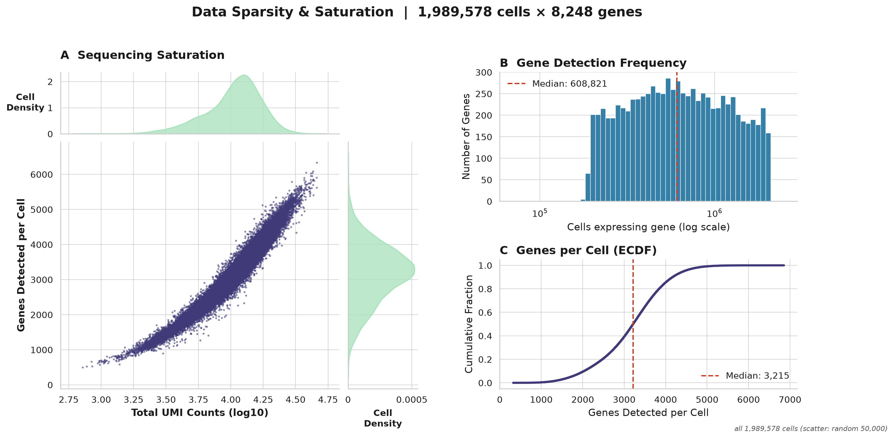
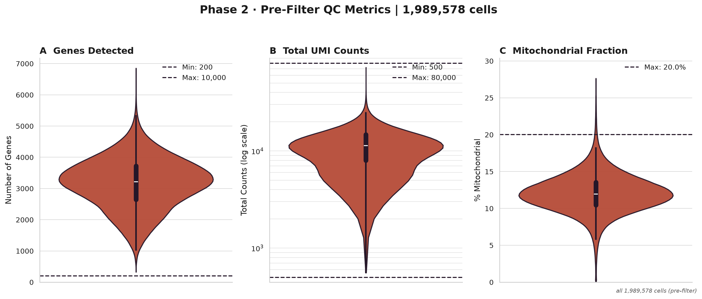
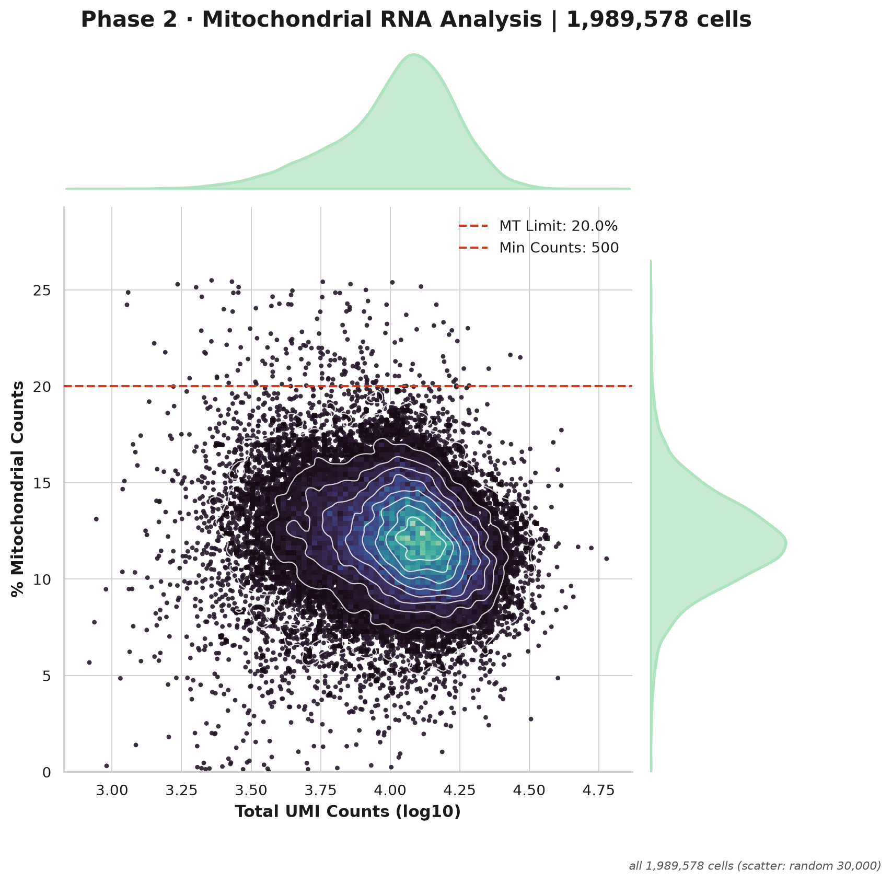
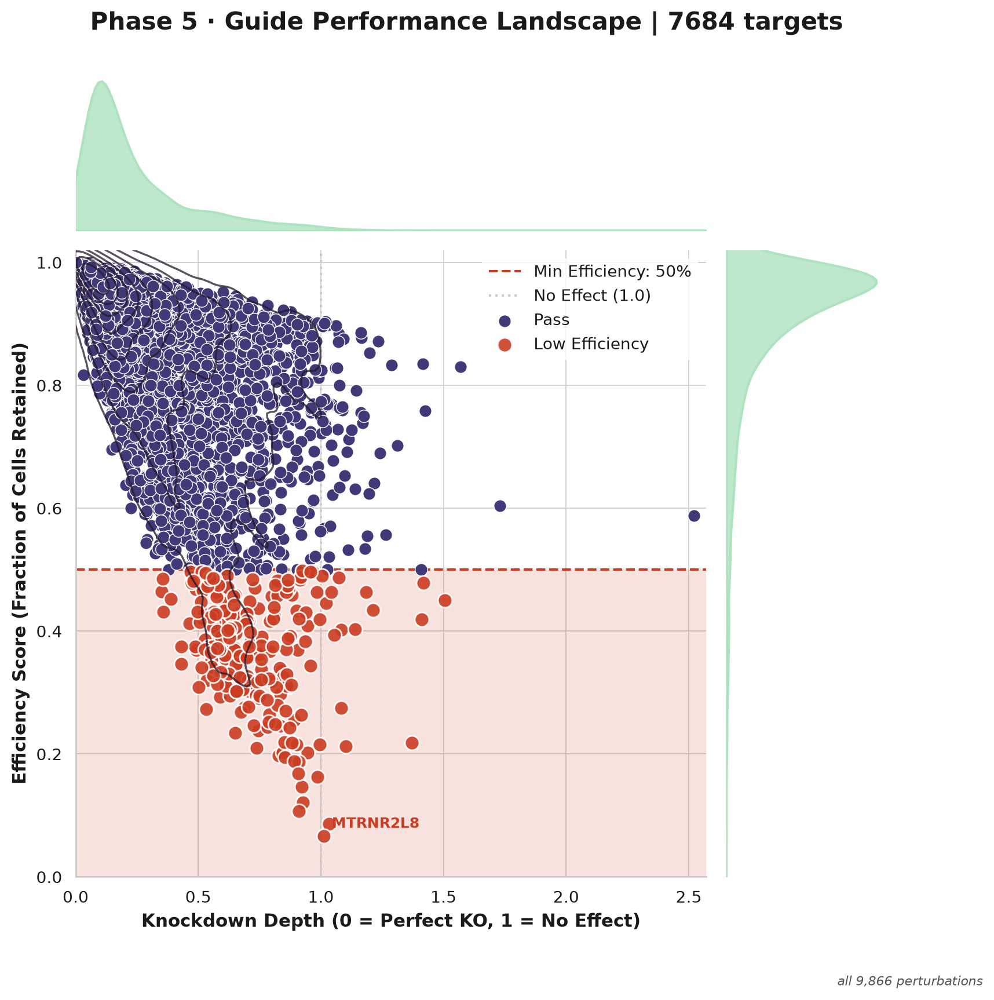
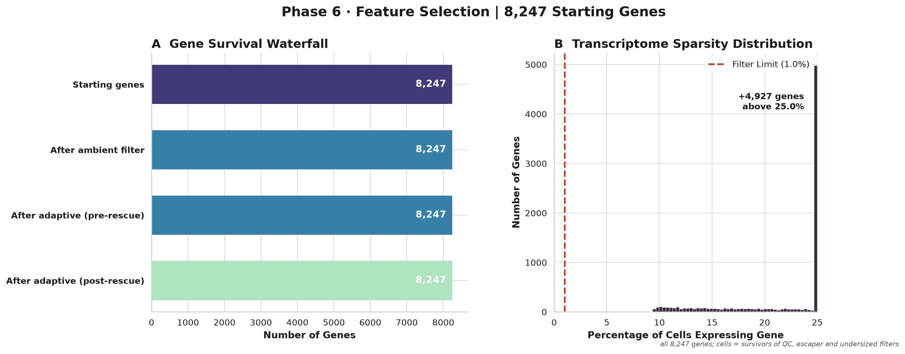
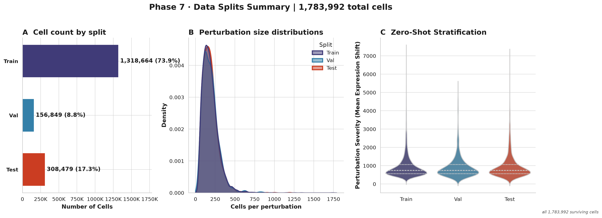
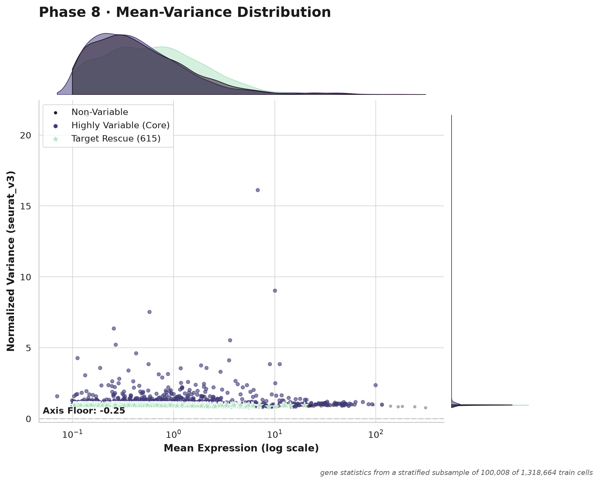
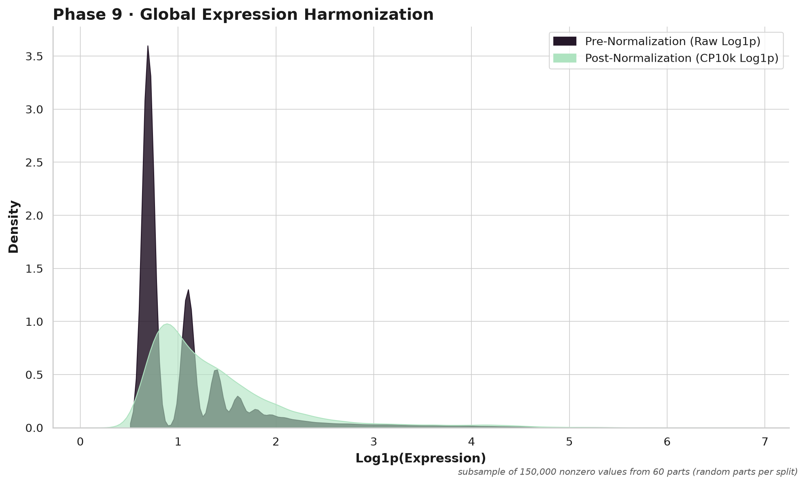

# SPORE-XL report: K562_GWPS

> K562 genome-wide screen (Replogle et al. 2022). Report written by SPORE-XL for this run; local paths removed.

## Figures

| figure | what | drawn from | status |
|---|---|---|---|
| sparsity_saturation.png | Input sparsity overview (phase 1-2) | all 1,989,578 cells (scatter: random 50,000) | ok |
| cell_qc_violin.png (alias p02_qc_violin.png) | Phase 3 cell QC violins | all 1,989,578 cells (pre-filter) | ok |
| cell_qc_mt_scatter.png (alias p02_mt_scatter.png) | Phase 3 cell QC MT scatter | all 1,989,578 cells (scatter: random 30,000) | ok |
| escaper_efficiency_scatter.png (alias p05_efficiency_scatter.png) | Phase 4 escaper filter / perturbation efficiency | all 9,866 perturbations | ok |
| gene_qc_dashboard.png (alias p06_triage_dashboard.png) | Phase 5 gene QC | all 8,247 genes; cells = survivors of QC, escaper and undersized filters | ok |
| split_dashboard.png (alias p07_splits_dashboard.png) | Phase 6 split | all 1,783,992 surviving cells | ok |
| hvg_dashboard.png (alias p08_hvg_dashboard.png) | Phase 7 HVG panel | gene statistics from a stratified subsample of 100,008 of 1,318,664 train cells | ok |
| normalization.png (alias p09_normalization.png) | Phase 8 normalization | subsample of 150,000 nonzero values from 60 parts (random parts per split) | ok |

No PCA / Harmony / cell-cycle-regression figures (old phase 10): that phase is not in the v4.0 core.

## Run summary

- cells in 1,989,578; survivors to Phase 7 1,783,992; controls 74,930; perturbations 9,118; genes kept by Phase 6 8,247
- split (perturbations): train 6720, val 800, test 1598
- HVG panel 5000 genes (policy and counts below)

## Intake summary

- source: kind `h5ad_rows`, `K562_gwps_raw_singlecell_01_sparse.h5ad`
- 1,989,578 cells and 8,248 genes enter the pipeline
- 9,866 perturbation labels and 75,328 control cells (`non-targeting`) before any QC

Cells dropped after the intake, and why (waterfall):

# WATERFALL (cells)

| step | cells | removed |
|---|---|---|
| in | 1,989,578 | |
| QC: After MT filter | 1,977,979 | 11,599 |
| QC: After min genes | 1,977,979 | 0 |
| QC: After max genes | 1,977,979 | 0 |
| QC: After min counts | 1,977,979 | 0 |
| QC: After max counts | 1,977,979 | 0 |
| escaper filter | 1,808,039 | 169,940 |
| undersized perturbations dropped (748 perturbations) | 1,783,992 | 24,047 |
| survivors to Phase 7 | 1,783,992 | |

cells in = survivors + removed: 1,989,578 = 1,783,992 + 11,599 (QC) + 169,940 (escapers) + 24,047 (undersized) -> RECONCILES

metacell units: 893,620 (680,190 in train_hybrid)
perturbation groups using the fallback embedding: 0

## Protected genes

- list: `protected_genes/protected_genes_K562.json` (name None, version 2.0); expression gate: off

## Perturbation-target node policy (phase 7, HVG panel; mode production)

- n_subsample: 100008
- n_train: 1318664
- n_panel: 5000
- n_genes_phase6: 8247
- n_ghosts_stacked: 0
- rescued_target: 615
- rescued_protected: 69
- rescued_heldout: 759
- target_node_policy: budget
- n_top_genes: 5000
- max_target_nodes: 3500
- panel_size: 5000
- panel_stacked_above_n_top: 0
- forced_heldout_targets: 1846
- forced_protected_genes: 184
- forced_cell_cycle_genes: 0
- train_targets_candidates: 5074
- train_targets_added: 1534
- train_targets_dropped_by_budget: 3540
- target_nodes_in_panel: 2709
- hvgs_from_variance_rank: 1485

Node perturbations (target gene is a column of the outputs) versus row-only perturbations (cells kept, target not a node); per perturbation in manifest/perturbation_nodes.tsv:

| reason | perturbations | cells |
|---|---|---|
| heldout_forced | 1,846 | 327,618 |
| hvg_variance_rank | 1,055 | 192,399 |
| protected | 120 | 20,910 |
| target_not_measured_or_removed_by_gene_qc | 2,078 | 437,182 |
| train_over_budget | 2,485 | 429,792 |
| train_ranked_in_budget | 1,534 | 301,161 |

## Escaper rules (phase 4; escaper_score = report)

Applied: rule 1 only. Per perturbation in reports/escaper_rules.tsv. Counts are over the QC-passing cells of the 9,866 perturbations.

| | cells | share of perturbation cells |
|---|---|---|
| rule 1 flags (target above the control 10th percentile) | 169,940 | 8.9% |
| rule 2 flags (response score, 9,787 perturbations where it could be computed) | 1,302,262 | 68.5% |
| flagged by both | 135,651 | |
| rule 1 only | 34,144 | |
| rule 2 only | 1,166,611 | |
| removed by the applied rule | 169,940 | 8.9% |

Rule 2 not computable for 79 perturbations: fewer than 20 cells 79.

Perturbations where rule 2 flags the most cells that rule 1 misses (candidates for the low-expressed-target blind spot):

| perturbation | cells | rule 1 | rule 2 | both |
|---|---|---|---|---|
| PINK1 | 1737 | 0 | 1515 | 0 |
| DUSP9 | 1344 | 0 | 1212 | 0 |
| STK38L | 1162 | 11 | 1022 | 11 |
| HBA2 | 1192 | 0 | 1010 | 0 |
| RAP1GAP | 1261 | 0 | 996 | 0 |
| FAM156B | 1001 | 0 | 958 | 0 |
| ESPN | 999 | 0 | 891 | 0 |
| PRODH | 935 | 0 | 847 | 0 |
| SIMC1 | 1158 | 203 | 1018 | 187 |
| CADM4 | 841 | 0 | 813 | 0 |

## Diagnostics (nothing is changed by them)

### Perturbation x batch confounding

- 267 batches; reference batch mix = controls (74,930 cells); a perturbation is flagged when its total variation distance (TVD) from the reference is >= 0.5 AND beyond random sampling of the same number of reference cells (Monte Carlo p <= 0.001); the fixed-threshold rule alone would flag 5092
- Cramer's V between perturbation and batch (perturbations with >= 20 cells): 0.074
- perturbations entirely in one batch: 0
- **WARNING: 22 of 9118 perturbations (2,933 of 1,709,062 cells) have a batch mix unlike the controls.** A model can learn the batch instead of the perturbation for these (worst 10 below; all in stats/reduce2/all/confounding.tsv)

| perturbation | cells | dominant batch | max share | TVD | TVD expected by chance | p |
|---|---|---|---|---|---|---|
| TUBGCP4 | 54 | 116 | 0.06 | 0.85 | 0.81 | 0.0005 |
| NDUFA2 | 57 | 173 | 0.09 | 0.84 | 0.80 | 0.0005 |
| SNRPB | 54 | 18 | 0.06 | 0.84 | 0.81 | 0.0005 |
| RPL21 | 61 | 100 | 0.07 | 0.83 | 0.79 | 0.0005 |
| RNPEPL1 | 98 | 100 | 0.03 | 0.73 | 0.69 | 0.0005 |
| RBM7 | 111 | 117 | 0.03 | 0.71 | 0.65 | 0.0005 |
| VAC14 | 129 | 126 | 0.03 | 0.66 | 0.61 | 0.0005 |
| BABAM1 | 153 | 91 | 0.03 | 0.61 | 0.56 | 0.0005 |
| EFCAB2 | 188 | 182 | 0.03 | 0.55 | 0.48 | 0.0005 |
| TCF12 | 195 | 105 | 0.02 | 0.53 | 0.47 | 0.0005 |

### Variance explained on the HVG subsample (train cells only, log-normalized panel genes)

100,008 cells x 5,000 genes. R2 = share of total variance; adjusted R2 corrects for the number of groups (perturbation has many groups, so only the adjusted value is comparable).

| factor | groups | R2 | adjusted R2 |
|---|---|---|---|
| perturbation | 6721 | 0.070751 | 0.003812 |
| batch | 267 | 0.014534 | 0.011906 |
| donor | - | not available (no donor column) | |

### Cell-cycle score diagnostic

- 41 S and 50 G2M genes present; score variance S 0.0298, G2M 0.0536
- phase fractions: {'G2M': 0.5234, 'S': 0.2933, 'G1': 0.1833}
- adjusted R2 of the scores by perturbation: S 0.010112047096933363, G2M 0.005557368248759742; by batch: S 0.006193866026649064, G2M 0.0077156491389238635

## Phase numbering (v4.0; old SPORE v3.0 numbers in the second column)

| v4 phase | name | v3.0 phase | config section |
|---|---|---|---|
| 1 | Intake / formatting | new | xl.source / recipe |
| 2 | Gene-ID harmonization | 1 | phase1_detection |
| 3 | Cell QC | 2 | phase2_cell_triage |
| 4 | Escaper filter + perturbation triage | 5 | phase5_escaper_filtering |
| 5 | Gene QC | 6 | phase6_gene_triage |
| 6 | Split | 7 | phase7_splits |
| 7 | HVG panel | 8 | phase8_hvg |
| 8 | Normalization | 9 | phase9_normalization |
| 9 | Metacell substrate | 12 | phase12_metacell |
| 10 | Verification + report | new | - |

Not in the core any more (future modules): v3.0 phases 3 ambient RNA, 4 doublets, 10 PCA / Harmony / cell-cycle regression, 11 cell-line separation. v3.0 output names are kept as aliases for one release (ON).

## Coverage and firewall

# K562_GWPS — SPORE substrate coverage + firewall verification
_(generated by the SPORE-XL final gate)_

- **held-out (val+test) target node coverage: 76.98%** (1846/2398)
  - val 78.5% (800 targets) · test 76.22% (1598 targets)
- missing held-out targets: 552 (never-measured ceiling: 552; measured-but-filtered: 0)

- **PASS ✓** — coverage at measurable ceiling (missing ⊆ never-measured)  (0 measured held-out targets missing)
- **PASS ✓** — train-hybrid firewall (0 val/test units)  (0 val/test units in train hybrid)
- **PASS ✓** — substrate is HVG-panel RAW counts  (5000 genes; control units integer=True; max=519.0)

- merge: merged files NOT written: projected 66.2 GB vs xl.merge_cap_gb 40 GB (xl.merge_split_outputs: never); the per-block parts under processed/ are the output

## ✅ GRAPH-READY

## Time and peak RSS per stage

| stage | units | peak RSS max (GB) | seconds sum | seconds max |
|---|---|---|---|---|
| finalize | 1 | 5.68 | 373.53 | 373.53 |
| gather | 130 | 4.27 | 2057.04 | 20.48 |
| hvg | 1 | 14.34 | 230.01 | 230.01 |
| map1 | 50 | 3.49 | 1097.18 | 24.16 |
| map2 | 50 | 1.45 | 1709.88 | 37.41 |
| map3 | 130 | 3.0 | 1322.61 | 18.42 |
| metacell | 130 | 6.77 | 2393.3 | 25.1 |
| metacell_prep | 1 | 8.77 | 108.5 | 108.5 |
| plan | 1 | 1.27 | 356.11 | 356.11 |
| reduce1 | 1 | 1.51 | 4.47 | 4.47 |
| reduce2 | 1 | 3.9 | 39.6 | 39.6 |

## Clean-up

not active (default): no intermediate file was removed.

## Figure gallery

**Input sparsity and saturation**

**Cell QC metrics before filtering**

**Mitochondrial fraction against UMI count**

**Knockdown efficiency and escaper calls per perturbation**

**Gene QC**

**Train / validation / test split**

**Highly variable gene panel**

**Normalization**

