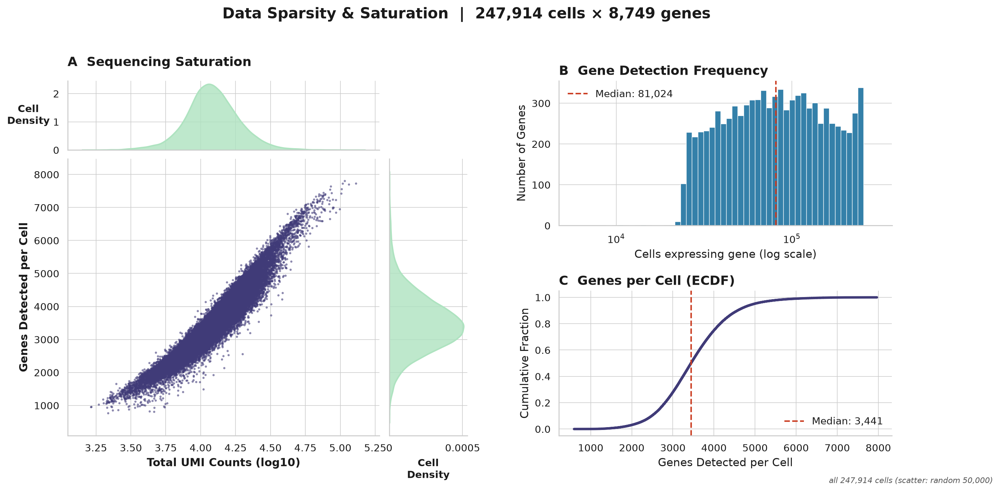
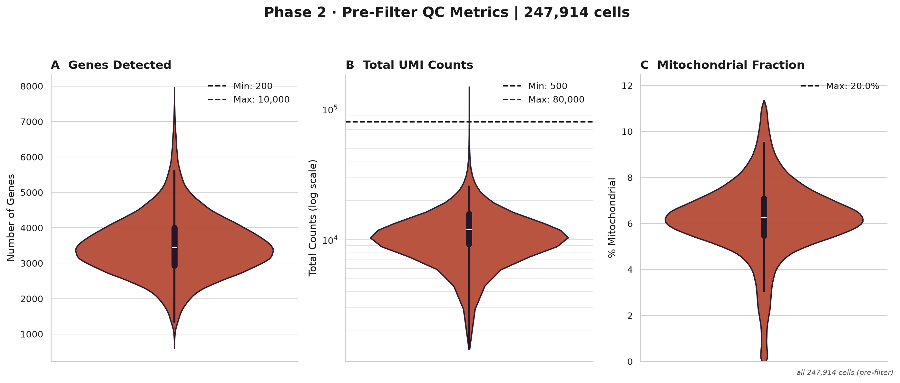
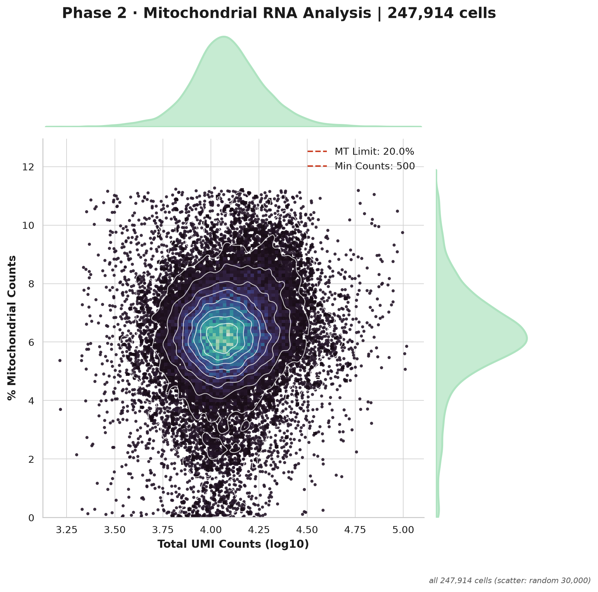
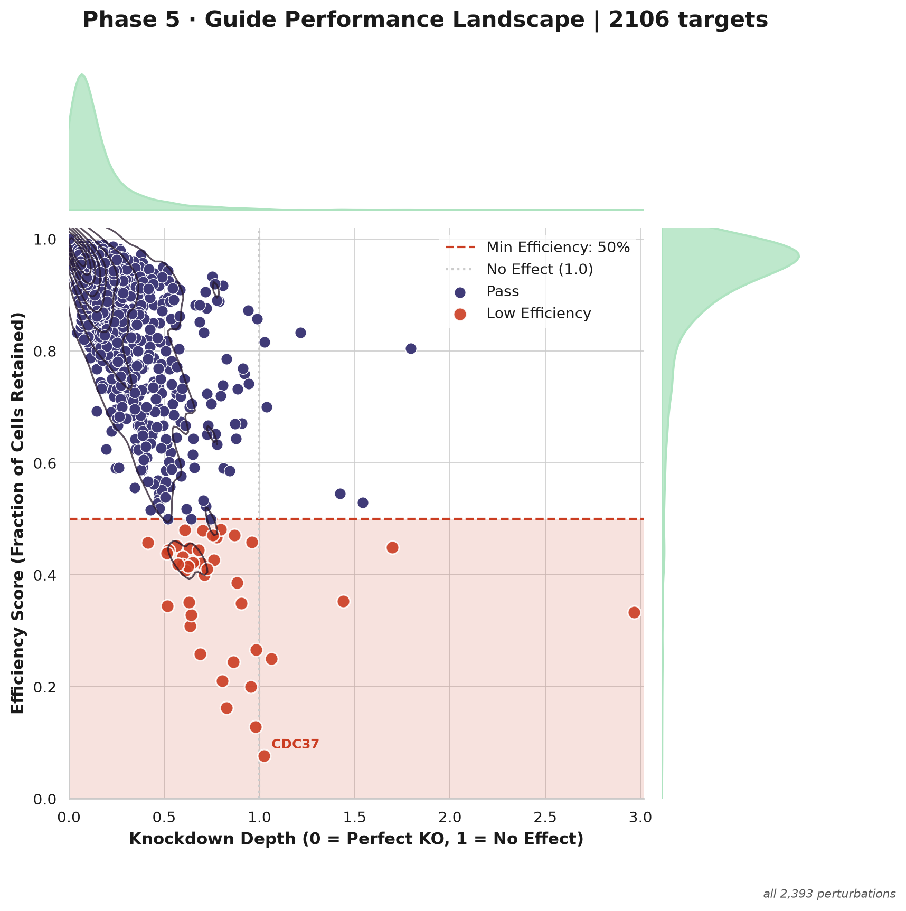
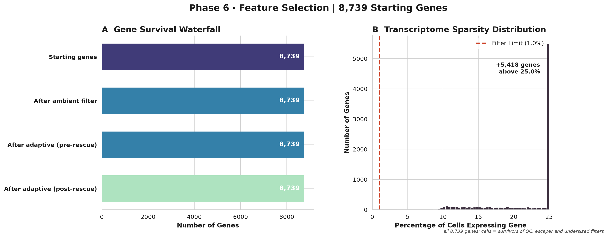
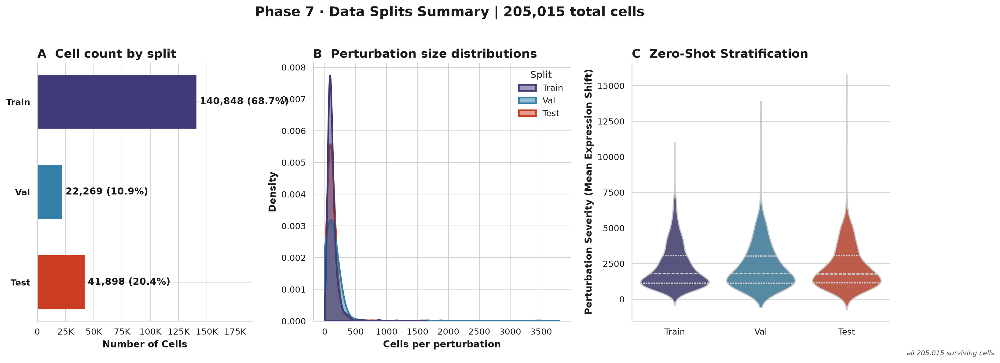
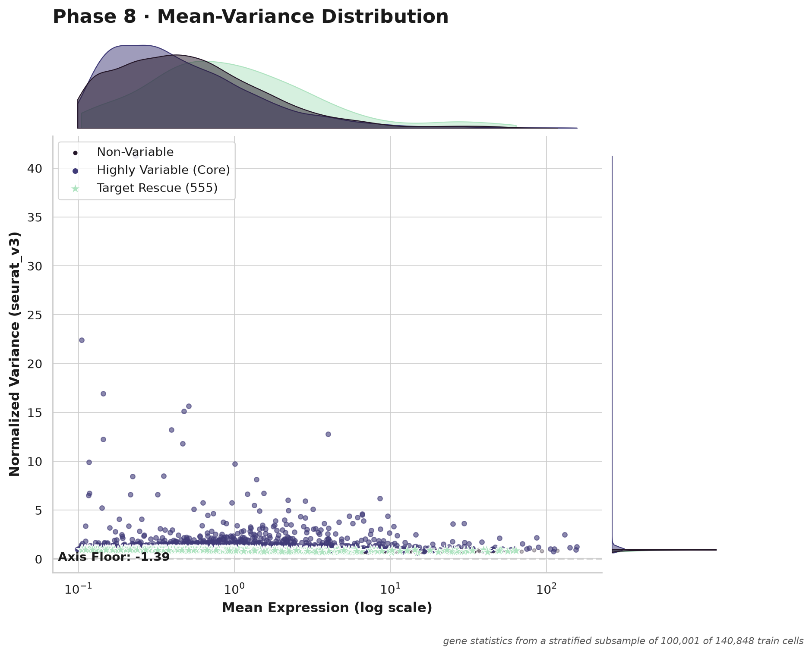
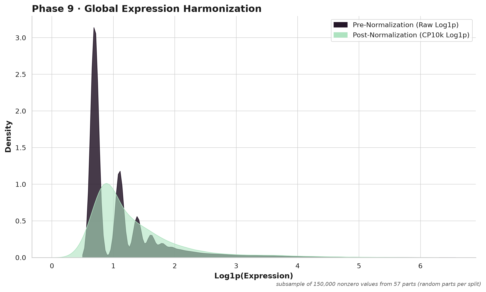

# SPORE-XL report: RPE1_essential

> RPE1 essential screen (Replogle et al. 2022). Report written by SPORE-XL for this run; local paths removed.

## Figures

| figure | what | drawn from | status |
|---|---|---|---|
| sparsity_saturation.png | Input sparsity overview (phase 1-2) | all 247,914 cells (scatter: random 50,000) | ok |
| cell_qc_violin.png (alias p02_qc_violin.png) | Phase 3 cell QC violins | all 247,914 cells (pre-filter) | ok |
| cell_qc_mt_scatter.png (alias p02_mt_scatter.png) | Phase 3 cell QC MT scatter | all 247,914 cells (scatter: random 30,000) | ok |
| escaper_efficiency_scatter.png (alias p05_efficiency_scatter.png) | Phase 4 escaper filter / perturbation efficiency | all 2,393 perturbations | ok |
| gene_qc_dashboard.png (alias p06_triage_dashboard.png) | Phase 5 gene QC | all 8,739 genes; cells = survivors of QC, escaper and undersized filters | ok |
| split_dashboard.png (alias p07_splits_dashboard.png) | Phase 6 split | all 205,015 surviving cells | ok |
| hvg_dashboard.png (alias p08_hvg_dashboard.png) | Phase 7 HVG panel | gene statistics from a stratified subsample of 100,001 of 140,848 train cells | ok |
| normalization.png (alias p09_normalization.png) | Phase 8 normalization | subsample of 150,000 nonzero values from 57 parts (random parts per split) | ok |

No PCA / Harmony / cell-cycle-regression figures (old phase 10): that phase is not in the v4.0 core.

## Run summary

- cells in 247,914; survivors to Phase 7 205,015; controls 11,483; perturbations 1,514; genes kept by Phase 6 8,739
- split (perturbations): train 1058, val 152, test 304
- HVG panel 5000 genes (policy and counts below)

## Intake summary

- source: kind `h5ad_rows`, `replogle_2022_rpe1.h5ad`
- 247,914 cells and 8,749 genes enter the pipeline
- 2,393 perturbation labels and 11,485 control cells (`non-targeting`) before any QC

Cells dropped after the intake, and why (waterfall):

# WATERFALL (cells)

| step | cells | removed |
|---|---|---|
| in | 247,914 | |
| QC: After MT filter | 247,914 | 0 |
| QC: After min genes | 247,914 | 0 |
| QC: After max genes | 247,914 | 0 |
| QC: After min counts | 247,914 | 0 |
| QC: After max counts | 247,827 | 87 |
| escaper filter | 230,181 | 17,646 |
| undersized perturbations dropped (879 perturbations) | 205,015 | 25,166 |
| survivors to Phase 7 | 205,015 | |

cells in = survivors + removed: 247,914 = 205,015 + 87 (QC) + 17,646 (escapers) + 25,166 (undersized) -> RECONCILES

metacell units: 103,681 (74,814 in train_hybrid)
perturbation groups using the fallback embedding: 0

## Protected genes

- list: `protected_genes/protected_genes_RPE1.json` (name None, version 1.0); expression gate: off

## Perturbation-target node policy (phase 7, HVG panel; mode production)

- n_subsample: 100001
- n_train: 140848
- n_panel: 5000
- n_genes_phase6: 8739
- n_ghosts_stacked: 0
- rescued_target: 555
- rescued_protected: 28
- rescued_heldout: 221
- target_node_policy: budget
- n_top_genes: 5000
- max_target_nodes: 3500
- panel_size: 5000
- panel_stacked_above_n_top: 0
- forced_heldout_targets: 390
- forced_protected_genes: 88
- forced_cell_cycle_genes: 0
- train_targets_candidates: 880
- train_targets_added: 880
- train_targets_dropped_by_budget: 0
- target_nodes_in_panel: 890
- hvgs_from_variance_rank: 3649

Node perturbations (target gene is a column of the outputs) versus row-only perturbations (cells kept, target not a node); per perturbation in manifest/perturbation_nodes.tsv:

| reason | perturbations | cells |
|---|---|---|
| heldout_forced | 390 | 50,738 |
| protected | 10 | 1,059 |
| target_not_measured_or_removed_by_gene_qc | 234 | 32,515 |
| train_ranked_in_budget | 880 | 109,220 |

## Escaper rules (phase 4; escaper_score = report)

Applied: rule 1 only. Per perturbation in reports/escaper_rules.tsv. Counts are over the QC-passing cells of the 2,393 perturbations.

| | cells | share of perturbation cells |
|---|---|---|
| rule 1 flags (target above the control 10th percentile) | 17,646 | 7.5% |
| rule 2 flags (response score, 2,204 perturbations where it could be computed) | 107,377 | 45.9% |
| flagged by both | 12,346 | |
| rule 1 only | 5,064 | |
| rule 2 only | 95,031 | |
| removed by the applied rule | 17,646 | 7.5% |

Rule 2 not computable for 189 perturbations: fewer than 20 cells 189.

Perturbations where rule 2 flags the most cells that rule 1 misses (candidates for the low-expressed-target blind spot):

| perturbation | cells | rule 1 | rule 2 | both |
|---|---|---|---|---|
| SLC1A5 | 1962 | 85 | 1673 | 81 |
| PPP6C | 1580 | 42 | 1062 | 32 |
| TARDBP | 1675 | 72 | 1028 | 56 |
| MYBL2 | 894 | 17 | 801 | 16 |
| NBPF12 | 1159 | 0 | 730 | 0 |
| GAB2 | 782 | 0 | 687 | 0 |
| GTF3C4 | 941 | 52 | 697 | 42 |
| FBXO42 | 883 | 7 | 638 | 6 |
| TWF1 | 686 | 74 | 668 | 72 |
| POGLUT3 | 784 | 16 | 561 | 15 |

## Diagnostics (nothing is changed by them)

### Perturbation x batch confounding

- 56 batches; reference batch mix = controls (11,483 cells); a perturbation is flagged when its total variation distance (TVD) from the reference is >= 0.5 AND beyond random sampling of the same number of reference cells (Monte Carlo p <= 0.001); the fixed-threshold rule alone would flag 1
- Cramer's V between perturbation and batch (perturbations with >= 20 cells): 0.090
- perturbations entirely in one batch: 0
- no perturbation is flagged

### Variance explained on the HVG subsample (train cells only, log-normalized panel genes)

100,001 cells x 5,000 genes. R2 = share of total variance; adjusted R2 corrects for the number of groups (perturbation has many groups, so only the adjusted value is comparable).

| factor | groups | R2 | adjusted R2 |
|---|---|---|---|
| perturbation | 1059 | 0.044817 | 0.034603 |
| batch | 56 | 0.020319 | 0.01978 |
| donor | - | not available (no donor column) | |

### Cell-cycle score diagnostic

- 41 S and 52 G2M genes present; score variance S 0.0394, G2M 0.1469
- phase fractions: {'G1': 0.419, 'G2M': 0.3081, 'S': 0.2729}
- adjusted R2 of the scores by perturbation: S 0.17411714119658672, G2M 0.11531375488063123; by batch: S 0.0005171927362345174, G2M 0.0026632780095056097

## Phase numbering (v4.0; old SPORE v3.0 numbers in the second column)

| v4 phase | name | v3.0 phase | config section |
|---|---|---|---|
| 1 | Intake / formatting | new | xl.source / recipe |
| 2 | Gene-ID harmonization | 1 | phase1_detection |
| 3 | Cell QC | 2 | phase2_cell_triage |
| 4 | Escaper filter + perturbation triage | 5 | phase5_escaper_filtering |
| 5 | Gene QC | 6 | phase6_gene_triage |
| 6 | Split | 7 | phase7_splits |
| 7 | HVG panel | 8 | phase8_hvg |
| 8 | Normalization | 9 | phase9_normalization |
| 9 | Metacell substrate | 12 | phase12_metacell |
| 10 | Verification + report | new | - |

Not in the core any more (future modules): v3.0 phases 3 ambient RNA, 4 doublets, 10 PCA / Harmony / cell-cycle regression, 11 cell-line separation. v3.0 output names are kept as aliases for one release (ON).

## Coverage and firewall

# RPE1_essential — SPORE substrate coverage + firewall verification
_(generated by the SPORE-XL final gate)_

- **held-out (val+test) target node coverage: 85.53%** (390/456)
  - val 86.18% (152 targets) · test 85.2% (304 targets)
- missing held-out targets: 66 (never-measured ceiling: 66; measured-but-filtered: 0)

- **PASS ✓** — coverage at measurable ceiling (missing ⊆ never-measured)  (0 measured held-out targets missing)
- **PASS ✓** — train-hybrid firewall (0 val/test units)  (0 val/test units in train hybrid)
- **PASS ✓** — substrate is HVG-panel RAW counts  (5000 genes; control units integer=True; max=806.0)

- merge: merged files NOT written: projected 7.5 GB vs xl.merge_cap_gb 40 GB (xl.merge_split_outputs: never); the per-block parts under processed/ are the output

## ✅ GRAPH-READY

## Time and peak RSS per stage

| stage | units | peak RSS max (GB) | seconds sum | seconds max |
|---|---|---|---|---|
| finalize | 1 | 1.82 | 46.77 | 46.77 |
| gather | 19 | 1.9 | 163.7 | 10.91 |
| hvg | 1 | 13.78 | 59.71 | 59.71 |
| map1 | 7 | 3.8 | 123.47 | 20.28 |
| map2 | 7 | 1.69 | 117.25 | 18.98 |
| map3 | 19 | 1.37 | 207.09 | 12.78 |
| metacell | 19 | 1.61 | 327.85 | 22.87 |
| metacell_prep | 1 | 7.72 | 26.38 | 26.38 |
| plan | 1 | 0.58 | 71.87 | 71.87 |
| reduce1 | 1 | 0.63 | 1.2 | 1.2 |
| reduce2 | 1 | 0.91 | 5.54 | 5.54 |

## Clean-up

not active (default): no intermediate file was removed.

## Figure gallery

**Input sparsity and saturation**

**Cell QC metrics before filtering**

**Mitochondrial fraction against UMI count**

**Knockdown efficiency and escaper calls per perturbation**

**Gene QC**

**Train / validation / test split**

**Highly variable gene panel**

**Normalization**

